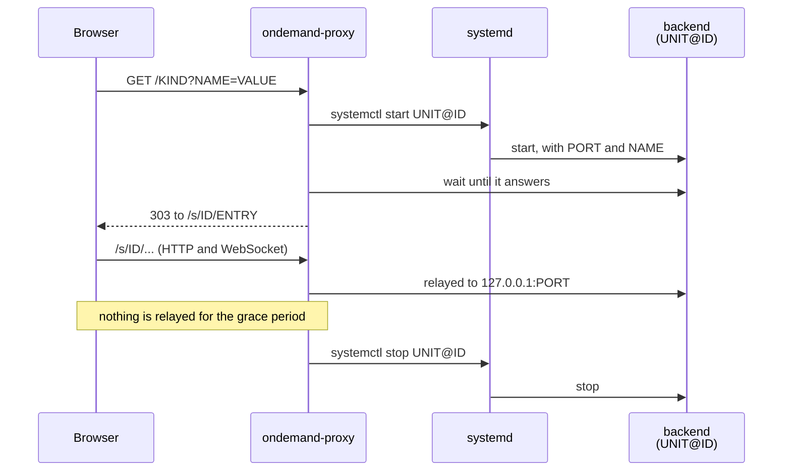

# ondemand-proxy

Open a URL and get a backend started for you alone, reached through the proxy,
and stopped once you leave.

The backend is anything that serves HTTP, such as a browser in a container
shown through noVNC, so a tool that only runs on a desktop can be used from
your own browser with nothing installed on your machine. Each one is a systemd
unit started from a template, one per request. The proxy relays HTTP and
WebSocket traffic to it, and asks systemd to stop it once nothing has been
relayed to it for a while.

`examples/` puts it to work opening a BMC's Web UI in such a browser. See
[examples/README.md](examples/README.md).



## Usage

Open `http://<host>:8080/<kind>?<name>=<value>`, with the parameters the kind
takes.

The proxy starts a session, waits for it to answer, and sends the browser into
it under `/s/<id>/`. Each request starts a session of its own, so two tabs are
two sessions.

A session is kept while any request to it is being relayed, which for a page
holding a WebSocket is as long as the page is open. Once nothing has been
relayed to it for the grace period, it is stopped. Open the URL again for a
new one.

A bad parameter is answered with 400, and a request made while every session is
taken with 503.

## Setting up

Put the binary in place, write the configuration and a template unit for each
kind (see [Adding a kind](#adding-a-kind)), and run the proxy as a service.

```
cp ondemand-proxy /usr/local/sbin/
mkdir -p /etc/ondemand-proxy
$EDITOR /etc/ondemand-proxy/config.json
cp examples/ondemand-proxy.service /etc/systemd/system/
systemctl daemon-reload
systemctl enable --now ondemand-proxy
```

The proxy speaks plain HTTP. Put it behind something that already decides who
may reach it, such as a forward proxy that asks for a client certificate, and
let a firewall keep everything else out.

```
ondemand-proxy [-config path] [-listen addr] [-run-dir path]
```

- `-config` is the configuration file, `/etc/ondemand-proxy/config.json` by
  default.
- `-listen` is the address to serve on, `:8080` by default.
- `-run-dir` is where each session's environment file is written,
  `/run/ondemand-proxy` by default.

## Configuration

The configuration is a JSON file, as in `examples/config.json`.

- `grace` is how long a session is kept once nothing is relayed to it.
- `ready_timeout` is how long a new unit has to start answering.
- Each session is given one port from `first_port`. `sessions` is how many
  ports there are, and so how many sessions can run at once. Choose it so that
  that many backends fit in the host's memory.
- `kinds` maps the name used in the URL to how that kind of session is run.
  - `unit` is the template unit, without `@` or `.service`.
  - `params` names the query parameters the kind takes. Each has to be given
    once, and its value may hold only letters, digits and `.` `_` `:` `-`.
    What the value means is left to the unit.
  - `entry` is where the browser is sent once the unit answers, relative to
    the session. `{id}` is replaced with the session id.

## Adding a kind

A kind is a template unit and an entry under `kinds`.

For each session the proxy writes `<id>.env` in `-run-dir`, with `PORT` and
each parameter upper-cased, then starts `<unit>@<id>.service`. The unit reads
the file with `EnvironmentFile=`, uses the values as `${NAME}`, and starts the
backend, which has to

- serve HTTP on `PORT`, on loopback only. Anything that reaches the port
  directly gets the session without going through the proxy.
- work under a path prefix. It is reached as `/s/<id>/`, so its pages have to
  load what they need by relative paths.

Stopping the unit has to stop the backend. `examples/ondemand-bmc@.service` is
one such unit.

## What the proxy asks of the host

The proxy needs no privilege beyond these, whether it is run as root or
granted them some other way.

- `systemctl start <unit>@<id>.service` and `systemctl stop <unit>@<id>.service`
  for each session. `<id>` is 32 hexadecimal digits.
- `systemctl stop <unit>@*.service` at start, for each kind, to stop sessions
  left behind by a proxy that died.
- Writing and removing `<id>.env` in `-run-dir`.

## License

This project is licensed under the [MIT License](LICENSE).
