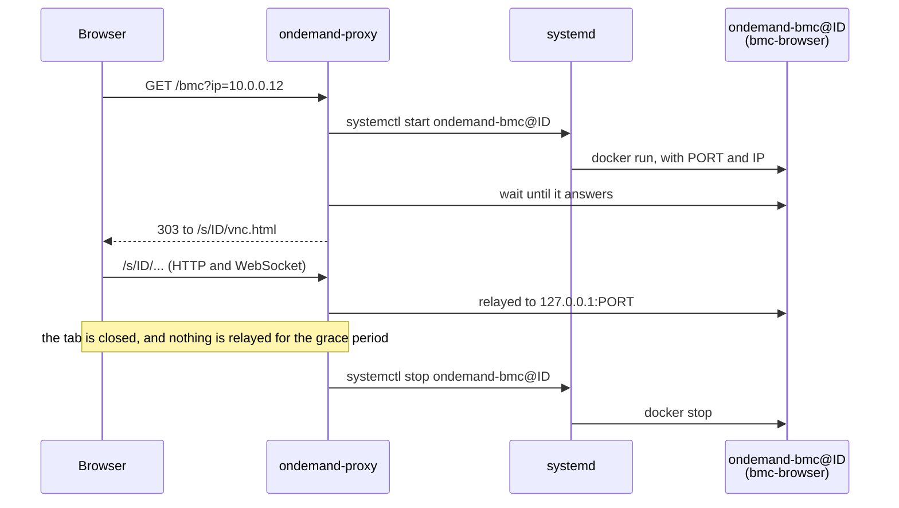

# Opening a BMC's Web UI

These files run [bmc-browser](https://github.com/zinrai/bmc-browser) for each
session: a throwaway container with Firefox on a BMC's Web UI, shown in your
own browser through noVNC.

- `config.json` defines the `bmc` kind, which takes `ip`.
- `ondemand-bmc@.service` runs bmc-browser for one session.
- `ondemand-proxy.service` runs the proxy.

## Setting up

From this directory, with the `ondemand-proxy` binary at hand:

```
cp ondemand-proxy /usr/local/sbin/
mkdir -p /etc/ondemand-proxy
cp config.json /etc/ondemand-proxy/config.json
cp ondemand-bmc@.service ondemand-proxy.service /etc/systemd/system/
docker pull ghcr.io/zinrai/bmc-browser
systemctl daemon-reload
systemctl enable --now ondemand-proxy
```

The unit caps each container at 1 GiB, so the 8 sessions in `config.json` need
about 8 GiB of memory. Lower `sessions` on a smaller host.

## Usage

Open `http://<host>:8080/bmc?ip=10.0.0.12`.

A BMC usually has a self-signed certificate, so Firefox in the session warns
about it before the BMC's login page. Close the tab, and the container is
stopped two minutes later.



What the unit has to do for the proxy is set out in
[Adding a kind](../README.md#adding-a-kind).
